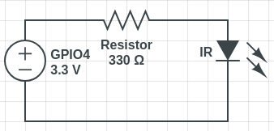
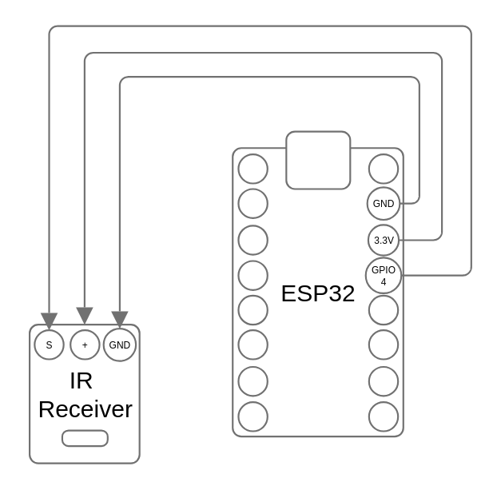
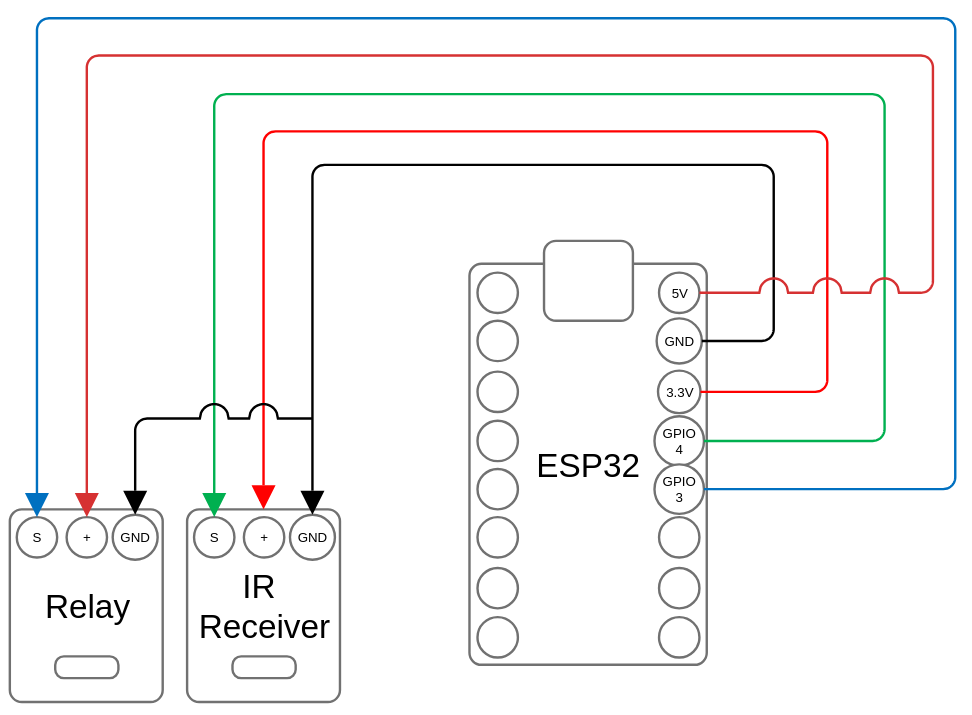

# IR Receiver test

Just tested how to reveice IR signals from a remote.

I used LG AKB72915269 remote. The code basically receives and reads
signals from IR receiver and converts them to hex format.

- [Code](IR-test/IR-test.ino)
- [LG Remote key bindings](LG_AKB72915269_key_bindings.md)

# IR Sender

This code send IR command (LG PWR BUTTON) via GPIO 4.
I used IR LED that was disassembled from old JVC remote. I also used 330 ohm resistor between VDC/VCC (3V3) and IR LED.

*Schematic created using [CircuitLab](https://circuitlab.com).*

- [Code](IR-sender/IR-sender.ino)

## Wiring diagram

# Relay controller

Same than above, but pressing remote button 1 turns relay on and button 2 turns relay off.

- [Code](IR-relay-controller/IR-relay-controller.ino)

