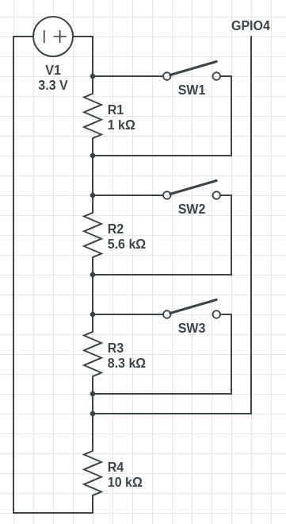

# Resistor ladder test

Tested how to make single GPIO handle three different buttons by measuring voltages.
This is maybe the simplest way to do it, but it's probably not the best way to do it.

Anyways, I used 1K, 5.6K, 8.3K and 10K ohm resistors in this project.
The 10K resistor is called pull-down resistor.
I also used three buttons. 

- [Code](Resistor-Ladder.ino)



*Schematic created using [CircuitLab](https://circuitlab.com).*

## Voltage measurements

| Button pressed | Voltage |
| :--- | :--- |
| Button 1 | 1.50 - 1.53 |
| Button 2 | 1.87 - 1.89 |
| Button 3 | 2.17 - 2.20 |
| All | 3.30 |

## Output from serial plotter

```
-> Top button pressed! 1.52V
-> Middle button pressed! 1.88V
-> Bottom button pressed! 2.19V
-> Many buttons pressed! 3.30V
```